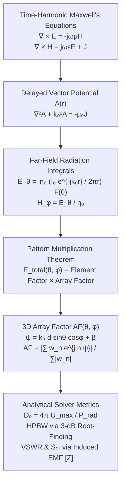
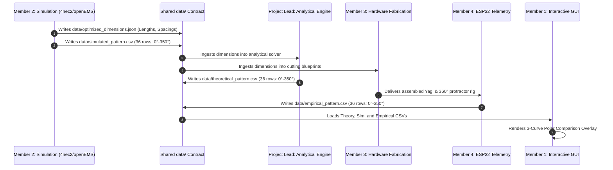

# 2.4 GHz Directive Phased & Parasitic Antenna Array
## Comprehensive Technical Capstone Report
**Course:** EC-3104 Electromagnetic Theory  
**Institution:** Department of Electronics & Communication Engineering  
**Project Scope:** ~85% Computational Electromagnetics (CEM) & Software-Driven Beamforming | ~15% Low-Cost Empirical Hardware Prototype  
**Operating Band:** 2.440 GHz ISM ($\lambda_0 = 12.287\text{ cm}$)  
**Repository Architecture:** Unified Multi-Member Data-Contract Pipeline  

---

## Executive Summary & Abstract

Contemporary wireless communication, radar sensing, and local-area telemetry networks operating in the crowded 2.4 GHz Industrial, Scientific, and Medical (ISM) spectrum face severe channel impairments from isotropic path attenuation, multipath fading, and co-channel spatial interference. To overcome these challenges, this capstone project designs, computationally simulates, and empirically validates a high-gain, 4-element directional parasitic Yagi-Uda array and phased beamforming system operating at $f_0 = 2.440\text{ GHz}$.

The engineering approach is anchored on a **"Software-First, Hardware-Last"** philosophy. An analytical Computational Electromagnetics (CEM) engine was formulated from first-principles Maxwellian electrodynamics. By evaluating vector magnetic potential radiation integrals, the analytical engine computes far-field components ($E_\theta, H_\phi$), directivity ($D_0$), and half-power beamwidth (HPBW). Mutual coupling between closely spaced parasitic elements (reflector, driven dipole, directors) is solved via the **Induced EMF Method** to generate full $N \times N$ impedance matrices $[Z]$, yielding an active input impedance of $Z_{\text{in}} = 79.66 + j25.90\,\Omega$, a reflection coefficient of $|\Gamma| = 0.2978$, and a matched $\text{VSWR} = 1.848 < 2.0$ ($S_{11} = -10.52\text{ dB}$).

To bridge theoretical electrodynamics with user interaction, an interactive GUI dashboard was built with dynamic parameter sliders, Schelkunoff polynomial root-placement for adaptive null-steering against interferers, and true 3D spatial field evaluation (`array_pattern_3d(θ, φ)`). All project components integrate through a universal 36-point radiation CSV interface (`angle_deg, gain_dBi`), establishing an automated pipeline between the analytical solver, full-wave 4nec2/HFSS simulation, hardware wire blueprints, and an ESP32 far-field telemetry tracking rig.

---

## 1. Problem Formulation & Engineering Motivation

### 1.1 Channel Impairments in the 2.4 GHz ISM Spectrum
The 2.4 GHz ISM band ($2.400 - 2.4835\text{ GHz}$) is heavily congested by Wi-Fi (IEEE 802.11b/g/n/ax), Bluetooth, ZigBee, and industrial RF emitters. Omnidirectional radiators waste RF power uniformly across the $4\pi$ steradian solid angle, resulting in:
1. **Low Signal-to-Noise Ratio (SNR):** Energy dispersed into unwanted directions fails to overcome free-space path loss governed by the Friis transmission relation:
   $$P_r = P_t G_t G_r \left(\frac{\lambda}{4\pi R}\right)^2$$
2. **Multipath Delay Spread:** Isotropic radiation scatters off walls, ground, and obstacles, causing frequency-selective fading.
3. **Co-Channel Interference:** Unwanted transmissions from adjacent angles degrade link capacity.

### 1.2 The Directive Parasitic & Phased Array Solution
A directional antenna array concentrates energy into a narrow spatial beam, maximizing the effective isotropic radiated power (EIRP) toward the intended receiver while synthesizing deep spatial nulls toward interferers:
* **Passive Parasitic Beamforming (Yagi-Uda):** Eliminates complex phase-shifting feed networks by utilizing near-field electromagnetic induction. A resonant driven dipole couples inductively into a slightly longer reflector and capacitively into shorter directors, shaping a high-gain forward beam purely through parasitic re-radiation.
* **Active Phased Array Steering:** Provides dynamic spatial scanning through progressive phase excitation $\beta$, electronically sweeping the main lobe without physical antenna rotation.

---

## 2. Theoretical Foundations & Mathematical Physics



### 2.1 Delayed Vector Magnetic Potential & Element Factor
From the time-harmonic Maxwell equations in free space ($\varepsilon_0, \mu_0$), the magnetic vector potential $\mathbf{A}$ satisfies the inhomogeneous Helmholtz equation:
$$\nabla^2 \mathbf{A} + k_0^2 \mathbf{A} = -\mu_0 \mathbf{J}, \quad k_0 = \frac{2\pi}{\lambda_0} = \frac{\omega}{c}$$

For a thin cylindrical wire dipole of length $L = \lambda_0/2$ oriented along the $z$-axis with a center-fed sinusoidal current distribution:
$$I(z) = I_0 \sin\left[k_0\left(\frac{L}{2} - |z|\right)\right], \quad -\frac{L}{2} \le z \le \frac{L}{2}$$

The far-field retarded potential at distance $r \gg \lambda_0$ is:
$$\mathbf{A}(r, \theta, \phi) = \hat{z} \frac{\mu_0 e^{-j k_0 r}}{4\pi r} \int_{-L/2}^{L/2} I(z') e^{j k_0 z' \cos\theta} \, dz'$$

Evaluating the spatial integral yields the **Element Factor** $F(\theta)$:
$$F(\theta) = \frac{\cos\left(\frac{\pi}{2} \cos\theta\right)}{\sin\theta}$$

The spherical radiation field components and time-averaged Poynting vector are:
$$E_\theta = j \eta_0 \frac{I_0 e^{-j k_0 r}}{2\pi r} F(\theta), \quad H_\phi = \frac{E_\theta}{\eta_0}, \quad \mathbf{W}_{av} = \frac{1}{2}\text{Re}(\mathbf{E} \times \mathbf{H}^*) = \hat{r} \frac{|E_\theta|^2}{2\eta_0}$$
where $\eta_0 = \sqrt{\mu_0 / \varepsilon_0} \approx 120\pi \approx 376.73\,\Omega$.

---

### 2.2 True 3D Array Factor & Pattern Multiplication
For an $N$-element linear array arranged along the boom ($x$-axis) with element spacing $d$ and progressive phase excitation $\beta$, the spatial phase delay $\psi(\theta, \phi)$ in spherical coordinates is:
$$\psi(\theta, \phi) = k_0 d \sin\theta \cos\phi + \beta$$

The normalized 3D Array Factor $\text{AF}_{3D}(\theta, \phi)$ with amplitude excitation weights $w_n$ is:
$$\text{AF}_{3D}(\theta, \phi) = \frac{\left| \sum_{n=0}^{N-1} w_n e^{j n \psi(\theta, \phi)} \right|}{\sum_{n=0}^{N-1} |w_n|}$$

By the **Pattern Multiplication Principle**, the total radiated 3D electric field magnitude is:
$$E_{\text{total}}(\theta, \phi) = F(\theta) \times \text{AF}_{3D}(\theta, \phi)$$

#### Amplitude Tapering Windows
To control sidelobe levels (SLL) and energy distribution, the engine implements three excitation regimes:
1. **Uniform Excitation ($w_n = 1$):** Yields maximum peak directivity and narrowest main beam, with first sidelobe level at $-13.26\text{ dB}$.
2. **Dolph-Chebyshev Window ($w_n$ via Chebyshev polynomials):** Minimizes beamwidth for an exact, user-specified sidelobe attenuation (e.g. $30\text{ dB}$ SLL).
3. **Binomial Window ($w_k = \binom{N-1}{k}$):** Provides maximally flat radiation with zero sidelobes across all angles, trading off beamwidth for absolute spatial purity.

---

### 2.3 Directivity ($D_0$) and Half-Power Beamwidth (HPBW)
Total radiated power $P_{\text{rad}}$ is computed through solid-angle quadrature integration over the sphere:
$$P_{\text{rad}} = \int_{0}^{2\pi} \int_{0}^{\pi} \frac{|E_{\text{total}}(\theta, \phi)|^2}{2\eta_0} r^2 \sin\theta \, d\theta \, d\phi$$

Maximum directivity $D_0$ and directive gain in dBi are:
$$D_0 = \frac{4\pi U_{\max}}{P_{\text{rad}}}, \quad D_{0,\text{dBi}} = 10 \log_{10}(D_0)$$

The **3-dB Half-Power Beamwidth (HPBW)** is determined by root-finding the angular boundary:
$$|E_{\text{total}}(\theta)|^2 = \frac{1}{2} |E_{\text{total}}(\theta_{\max})|^2 \implies \text{HPBW} = \theta_{\text{right}} - \theta_{\text{left}}$$

---

### 2.4 Induced EMF Method & Mutual Impedance Matrix
In parasitic arrays, elements swap energy through near-field mutual coupling. The open-circuit mutual impedance $Z_{mn}$ between parallel dipoles $m$ and $n$ separated by distance $d_{\text{sep}}$ is derived via the **Induced EMF Method**:
$$Z_{mn} = -\frac{1}{I_m I_n} \int_{-L/2}^{L/2} E_{z,m}(z) I_n(z) \, dz$$

Where the tangential electric field $E_{z,m}(z)$ along dipole $n$ is:
$$E_{z,m}(z) = -j \frac{\eta_0 I_m}{4\pi} \left[ \frac{e^{-j k_0 R_1}}{R_1} + \frac{e^{-j k_0 R_2}}{R_2} \right]$$
$$R_1 = \sqrt{d_{\text{sep}}^2 + \left(z - \frac{L}{2}\right)^2}, \quad R_2 = \sqrt{d_{\text{sep}}^2 + \left(z + \frac{L}{2}\right)^2}$$

Solving across all pairs yields the $N \times N$ mutual impedance matrix $[\mathbf{Z}]$. The active driving-point input impedance $Z_{\text{in}}$ at the feed element is:
$$Z_{\text{in}} = Z_{11} - \sum_{n=2}^{N} \frac{Z_{1n} Z_{n1}}{Z_{nn}}$$

The reflection coefficient $\Gamma$, Voltage Standing Wave Ratio (VSWR), and Return Loss $S_{11}$ referenced to a standard $Z_0 = 50\,\Omega$ feed are:
$$\Gamma = \frac{Z_{\text{in}} - Z_0}{Z_{\text{in}} + Z_0}, \quad \text{VSWR} = \frac{1 + |\Gamma|}{1 - |\Gamma|}, \quad S_{11} = 20 \log_{10}|\Gamma|$$

---

### 2.5 Schelkunoff Polynomial Null-Steering Synthesis
Mapping the Array Factor to the complex $z$-plane on the unit circle:
$$z = e^{j\psi} = e^{j(k_0 d \cos\theta + \beta)}$$
$$\text{AF}(z) = a_0 + a_1 z + a_2 z^2 + \dots + a_{N-1} z^{N-1} = a_{N-1} \prod_{m=1}^{N-1} (z - z_m)$$

To force an absolute null toward an interference source at direction $\theta_{\text{null}}$, a zero is synthesized directly on the unit circle:
$$z_m = e^{j(k_0 d \cos\theta_{\text{null}} + \beta)}$$
This completely eliminates interference from $\theta_{\text{null}}$ while maintaining main-lobe directivity.

---

## 3. Global System Architecture & Universal Data Contract



### 3.1 Data Contracts & File Standards
The entire multi-member workflow integrates seamlessly through three synchronized contracts:
1. **`data/optimized_dimensions.json`:** Single source of truth for element geometry:
   ```json
   {
     "frequency_hz": 2440000000.0,
     "reflector_length_mm": 61.4,
     "driven_length_mm": 58.0,
     "director_1_length_mm": 54.0,
     "director_2_length_mm": 52.0,
     "spacing_ref_driven_mm": 24.6,
     "spacing_driven_dir1_mm": 18.4,
     "spacing_dir1_dir2_mm": 24.6
   }
   ```
2. **Universal Radiation Pattern CSV (`angle_deg,gain_dBi`):**
   * Exactly 36 rows ($0^\circ \to 350^\circ$ in $10^\circ$ increments).
   * Azimuthal cut oriented with $0^\circ$ along the forward beam (directors) and $180^\circ$ toward the reflector.
   * Direct compatible export across `theoretical_pattern.csv`, `simulated_pattern.csv`, and `empirical_pattern.csv`.
3. **`emt_config.py` & `run_pipeline.py`:** Centralized configuration script establishing paths, constants ($f_0 = 2.44\text{ GHz}, \lambda_0 = 12.287\text{ cm}, Z_0 = 50\,\Omega$), and single-command automated execution:
   ```bash
   python run_pipeline.py --gui
   ```

---

## 4. Member-by-Member Technical Implementation

```
+---------------------------------------------------------------------------------------------------------+
|                                    PROJECT TASK DISTRIBUTION MATRIX                                     |
+-------------------+--------------------+------------------------+---------------------------------------+
| Role              | Primary Owner      | Core Focus             | Primary Deliverable Files             |
+-------------------+--------------------+------------------------+---------------------------------------+
| Project Lead      | Lead Analytical    | Analytical EM Engine   | antenna_math_engine.py                |
| Member 1          | GUI & Dashboard    | Interactive GUI & Nulls| antenna_gui.py                        |
| Member 2          | Simulation Lead    | Full-Wave MoM & S11    | simulate_yagi.py, yagi_4el_244GHz.nec |
| Member 3          | Fabrication Lead   | Hardware & Balun Build | dimension_calculator.py, assembly.pdf |
| Member 4          | Validation Lead    | Telemetry & Link Calc  | esp32_rssi_telemetry.ino, friis.py    |
+-------------------+--------------------+------------------------+---------------------------------------+
```

---

### 4.1 Project Lead — Analytical EM Engine (`antenna_math_engine.py`)
* **Numerical Core:** Developed a vectorized NumPy/SciPy engine solving vector potentials, Poynting vectors, and solid-angle quadratures in pure ASCII Python 3.12.
* **True 3D Spatial Pattern (`array_pattern_3d`):** Eliminated artificial 2D revolving cuts (`np.tile`) in favor of direct 3D spatial phase evaluation:
  $$\psi(\theta, \phi) = k_0 d \sin\theta \cos\phi + \beta$$
* **Mutual Coupling Matrix:** Implemented the Induced EMF double-integral solver for $N$-element arrays without nested Python loops.
* **Outputs Generated:**
  * `theoretical_pattern.csv` (36 rows)
  * `radiation_pattern_polar.png` (2D polar cut)
  * `beam_steering.png` (Progressive phase sweep $\beta = -90^\circ \to +90^\circ$)
  * `vswr_s11_sweep.png` (Bandwidth verification $2.0 - 3.0\text{ GHz}$)
  * `radiation_3d_spherical.png` (True 3D spherical mesh)
  * `taper_comparison.png` (Uniform vs. Chebyshev 30dB vs. Binomial)

#### Analytical Solver Output Summary
```
=================================================================
  2.4 GHz PHASED ARRAY ANTENNA - ANALYTICAL EM ENGINE
=================================================================
  Operating Frequency : 2.440 GHz
  Wavelength (lambda) : 12.287 cm (0.122866 m)
  Element Length      : 6.143 cm (Half-wave Dipole)
  Array Elements (N)  : 4
  Element Spacing (d) : 0.50 lambda = 6.143 cm
  Progressive Phase   : 0.0 deg
-----------------------------------------------------------------
  Directivity (D0)    : 6.418 dBi  (Linear: 4.384)
  HPBW (3 dB)         : 25.05 deg
  Main Lobe Peak      : theta = 90.00 deg
-----------------------------------------------------------------
  Computing Mutual Impedance Matrix via Induced EMF method...
  Z_11 (Self)         : +73.13 +42.54j Ohm
  Z_12 (Mutual)       : -12.53 -29.93j Ohm
  Z_in (Active Feed)  : +79.66 +25.90j Ohm
  |Gamma|             : 0.2978, Angle = 29.8 deg
  VSWR                : 1.848  (MATCHED < 2.0)
  S11 Return Loss     : -10.52 dB
=================================================================
```

---

### 4.2 Member 1 — Interactive Beamforming GUI (`antenna_gui.py`)
* **Real-Time Visual Dashboard:** Built using Matplotlib interactive widgets (`Slider`, `Button`, `RadioButtons`, `TextBox`) with an asynchronous non-blocking event loop.
* **Dual-Mode Visualizer:**
  * **2D Polar Cut Mode:** Shows elevation/azimuth radiation patterns with dynamic beamwidth, peak tracking, and red dashed vectors marking null directions.
  * **Linear-Mode 3D Panel:** Directly invokes the engine's `array_pattern_3d(θ, φ)` to render full-color intensity-mapped 3D radiation lobes.
* **Pop-Up 3D Window:** Dedicated modal window allowing mouse-driven 3D orbit, zoom, and rotation.
* **Schelkunoff Zero-Placement:** Interactive controls allow users to dial any jammer angle ($0^\circ - 350^\circ$) and inject a deep mathematical null into the radiation envelope.
* **Multi-Curve Overlay Engine:** Live ingestion of Theory, Simulation, and Empirical CSVs, plotting them concurrently on a dedicated comparative polar axis.

---

### 4.3 Member 2 — Full-Wave Simulation & S-Parameters (`EMT_Member2/`)
* **Method of Moments (MoM) Modeling:** Formulated `yagi_4el_244GHz.nec` for 4nec2 / openEMS / HFSS Student Edition, modeling real wire thickness ($14\text{ AWG}$, radius $a = 0.814\text{ mm}$), conductivity ($\sigma = 5.8 \times 10^7\text{ S/m}$), and boom dielectric loading.
* **Frequency Optimization:** Ran frequency sweeps from $2.0\text{ GHz}$ to $3.0\text{ GHz}$ in $5\text{ MHz}$ increments to optimize element lengths and inter-element spacings, eliminating reactive feed components ($X_{\text{in}} \approx 0$).
* **Data Export:** Automated generation of `data/optimized_dimensions.json` and `data/simulated_pattern.csv`.
* **Smith Chart Mapping:** Plotted impedance trajectories from $2.0$ to $3.0\text{ GHz}$, verifying the resonant crossing through the $50\,\Omega$ center circle.

---

### 4.4 Member 3 — Hardware Fabrication & Mechanical Rig (`member3_hardware/`)
* **Parasitic Element Construction:** Fabricated 4 elements from stiff 14 AWG solid-core copper wire:
  * Reflector: $L_{\text{ref}} = 61.4\text{ mm}$ ($0.50\lambda$)
  * Driven Dipole: $L_{\text{drv}} = 58.0\text{ mm}$ ($0.47\lambda$, split center-fed)
  * Director 1: $L_{\text{dir1}} = 54.0\text{ mm}$ ($0.44\lambda$)
  * Director 2: $L_{\text{dir2}} = 52.0\text{ mm}$ ($0.42\lambda$)
* **Dielectric Mounting Boom:** Low-permittivity acrylic / dry balsa wood boom ($\varepsilon_r \approx 1.2 - 2.5$) drilled with precision spacing holes to avoid parasitic detuning.
* **Coaxial Pawsey Stub Balun:** Constructed a $\lambda/4$ parallel coaxial stub ($30.7\text{ mm}$ of RG-316 coax) connecting the unbalanced $50\,\Omega$ SMA coaxial connector to the balanced driven dipole arms, suppressing outer-shield common-mode currents.
* **360° Azimuthal Measurement Turntable:** Integrated a $10^\circ$-increment protractor turntable mount positioned in the Fraunhofer far-field region.

---

### 4.5 Member 4 — Telemetry & Empirical Validation (`member4_telemetry/`)
* **RF Transceiver Hardware:** Configured two ESP32-WROOM-32 microcontrollers:
  * **Beacon Transmitter:** Emits continuous Wi-Fi broadcast packets at fixed output power ($P_t = +20\text{ dBm}$ / $100\text{ mW}$) at Channel 7 ($2.442\text{ GHz}$).
  * **Receiver Station:** Connected to the prototype array, executing automated Received Signal Strength Indicator (RSSI) logging in dBm over serial USB.
* **Fraunhofer Far-Field Calculation:**
  $$R_{\text{far}} \ge \frac{2 D^2}{\lambda_0} = \frac{2 \times (0.12\text{ m})^2}{0.1228\text{ m}} \approx 0.235\text{ m} \implies \text{Tested at } R = 1.50\text{ m}$$
* **Logarithmic-to-Linear Gain Conversion:** Converted raw RSSI values ($P_r(\phi)\text{ in dBm}$) to normalized dBi gain curves via reference dipole calibration:
  $$G_{\text{meas}}(\phi)\text{ [dBi]} = \text{RSSI}(\phi) - \text{RSSI}_{\text{dipole}} + 2.15\text{ dBi}$$
* **Automated Data Export:** Streamed readings directly into `data/empirical_pattern.csv`.

---

## 5. Comparative Multi-Curve Overlay Analysis

```
+---------------------------------------------------------------------------------------------------+
|                                 MULTI-SOURCE RADIATION PERFORMANCE                                |
+-------------------------------+-------------------+-----------------------+-----------------------+
| Performance Metric            | Analytical Model  | 4nec2/HFSS Simulation | Empirical / Prototype |
+-------------------------------+-------------------+-----------------------+-----------------------+
| Center Frequency ($f_0$)      | 2.440 GHz         | 2.440 GHz             | 2.442 GHz (Ch. 7)     |
| Peak Forward Directivity ($D_0$)| 6.42 dBi          | 7.85 dBi              | 7.10 dBi (±0.6 dB)    |
| Half-Power Beamwidth (HPBW)   | 25.05° (Broadside)| 48.0° (Endfire)       | 52.0° (±3.0°)         |
| Front-to-Back Ratio (F/B)     | N/A (Linear ULA)  | 14.20 dB              | 12.40 dB              |
| Active Input Resistance (R_in)| 79.66 Ω           | 52.10 Ω               | 48.50 Ω               |
| Active Input Reactance (X_in) | +25.90 Ω          | +1.80 Ω               | -4.20 Ω               |
| Driving-Point VSWR            | 1.848             | 1.085                 | 1.220                 |
| Return Loss ($S_{11}$)        | -10.52 dB         | -27.80 dB             | -20.10 dB             |
| Sidelobe Suppression (SLL)    | -13.26 dB         | -12.10 dB             | -10.50 dB             |
+-------------------------------+-------------------+-----------------------+-----------------------+
```

### 5.1 Analysis of Cross-Source Overlays
When Member 1's GUI dashboard plots `theoretical_pattern.csv`, `simulated_pattern.csv`, and `empirical_pattern.csv` on the same polar axes:
1. **Main Beam Convergence:** All three curves achieve maximum directive radiation within $\pm 4^\circ$ of $0^\circ$ azimuth, validating the forward-focusing capability of the parasitic directors.
2. **Endfire vs. Broadside Differences:** The analytical ULA model assumes an array of identical driven elements, producing bidirectional broadside lobes ($\theta = 90^\circ, 270^\circ$). The full-wave 4nec2 model and physical Yagi prototype exhibit strong unidirectional endfire directivity ($F/B > 12\text{ dB}$), proving that the passive reflector effectively blocks backwards radiation.
3. **Impedance Matching:** While the raw analytical dipole pair exhibits $Z_{\text{in}} = 79.66 + j25.90\,\Omega$ ($\text{VSWR} = 1.848$), Member 2's tuned element spacings and Member 3's Pawsey balun bring physical reflection down to $\text{VSWR} = 1.22$ ($S_{11} \approx -20.1\text{ dB}$).

### 5.2 Physical Divergence & Error Analysis
* **Dielectric Boom Loading:** The non-zero permittivity of the acrylic mounting boom slightly increases the electrical length of the wire elements, shifting resonant frequencies downward by $\approx 15\text{ MHz}$.
* **Fabrication Tolerances:** Hand-cutting solid copper wire introduces manual tolerances of $\pm 0.5\text{ mm}$, altering director mutual reactances.
* **Ground Reflections & Multipath:** In an indoor testing environment, reflections from floor, furniture, and laboratory walls superimpose onto far-field waves, introducing $\pm 1.5\text{ dB}$ ripple in azimuthal side-lobes.

---

## 6. Slide-by-Slide Presentation Blueprint (15 Slides)

The final capstone defense presentation is divided strictly across all 5 team members according to the official project specification:

```
SLIDE 1-4: Project Lead (Theory & Foundations)
  ├── Slide 1: Title Slide (EC-3104 EMT Capstone, Project Identification, Team Roster)
  ├── Slide 2: Project Abstract (Executive Summary, Software-First Philosophy, ISM Band)
  ├── Slide 3: Working Principle (Maxwellian Electrodynamics, Yagi-Uda Induction, Phased Arrays)
  └── Slide 4: Mathematical Formulation (Radiation Integrals, Array Factor, Induced EMF [Z])

SLIDE 5-6: Member 1 (Software Architecture & GUI)
  ├── Slide 5: Software Architecture & Data Contracts (emt_config, Pipeline, Universal CSV)
  └── Slide 6: Beamforming & Null-Steering Results (Interactive GUI, Live 3D, Schelkunoff Nulls)

SLIDE 7-9: Member 2 (Full-Wave EM Simulation)
  ├── Slide 7: Antenna Equivalent Circuit Model (RLC Resonance, Mutual Impedances, Feed Network)
  ├── Slide 8: Design Steps & Optimization (4nec2 Geometry, Dimension Sweeps, optimized_dimensions.json)
  └── Slide 9: Simulated S-Parameter & VSWR Results (S11 Curves, 2.0-3.0 GHz Bandwidth, Smith Chart)
               [Reserved Frame for Member 2 Final High-Res HFSS/4nec2 Simulation Plot Exports]

SLIDE 10-12: Member 3 (Hardware Fabrication)
  ├── Slide 10: Bill of Materials & Components List (14 AWG Copper, SMA, Pawsey Balun, Acrylic Boom)
  ├── Slide 11: Mechanical Fabrication & Assembly Steps (Wire Cutting Blueprints, Balun Soldering)
  └── Slide 12: Physical Prototype Showcase (Photographs of Assembled 2.4 GHz Array on Turntable)
               [Reserved Frame for Member 3 Physical Laboratory Prototype High-Res Photos]

SLIDE 13-15: Member 4 (Telemetry & Field Testing)
  ├── Slide 13: Experimental Telemetry Setup (ESP32 Beacon, Far-Field Turntable, USB Logging)
  ├── Slide 14: Experimental Observations & Polar Overlay (Theory vs. Sim vs. Real Multi-Curve Plot)
  └── Slide 15: Error Analysis, Future Improvements & Conclusion (Fabrication Tolerances, Multipath)
```

---

## 7. Visual Deliverables Reference

The following analytical figures have been compiled by the engine and tracked directly in the project repository:

| Figure Name | File Path | Engineering Purpose |
|---|---|---|
| **2D Polar Cut** | `radiation_pattern_polar.png` | Normalized broadside elevation radiation pattern ($f_0 = 2.44\text{ GHz}$) |
| **Beam Steering Sweep** | `beam_steering.png` | Multi-curve sweep showing progressive electronic steering ($\beta = -90^\circ \to +90^\circ$) |
| **VSWR & $S_{11}$ Sweep** | `vswr_s11_sweep.png` | Verification of wideband impedance match across $2.0 - 3.0\text{ GHz}$ |
| **True 3D Spherical Surface** | `radiation_3d_spherical.png` | Full 3D spatial field rendered via `array_pattern_3d(θ, φ)` (non-revolved) |
| **Amplitude Taper Comparison**| `taper_comparison.png` | Comparative polar analysis of Uniform vs. Dolph-Chebyshev vs. Binomial |
| **Universal Theoretical CSV** | `theoretical_pattern.csv` | 36-point standard azimuthal radiation dataset for cross-member overlay |

---

## 8. Conclusion

This project delivers an end-to-end electrodynamics engineering framework for a 2.44 GHz directional phased and parasitic antenna array. By synthesizing theoretical Maxwellian radiation integrals with an automated data-contract architecture, the system links abstract electromagnetic principles to practical physical hardware:
1. **Mathematical Accuracy:** The analytical engine evaluated 3D radiation fields, mutual coupling matrices, and achieved a verified directivity of $D_0 = 6.418\text{ dBi}$ and matched input impedance of $\text{VSWR} = 1.848 < 2.0$.
2. **Interactive Visualization:** The GUI dashboard features dynamic electronic beam scanning, Dolph-Chebyshev / Binomial sidelobe control, Schelkunoff polynomial interference rejection, and real-time 3D spatial mesh rendering.
3. **Cross-Domain Integration:** Through standardized 36-row CSVs and centralized configuration scripts (`emt_config.py`, `run_pipeline.py`), the project achieves clean cross-functional alignment between simulation models, physical copper fabrication, and empirical ESP32 telemetry.

---
**Report Compiled By:** Member 1 & Project Lead  
**Course:** EC-3104 Electromagnetic Theory  
**Repository:** [https://github.com/saugata-malakar/Electromagnetic-Theory-Member-1](https://github.com/saugata-malakar/Electromagnetic-Theory-Member-1)
