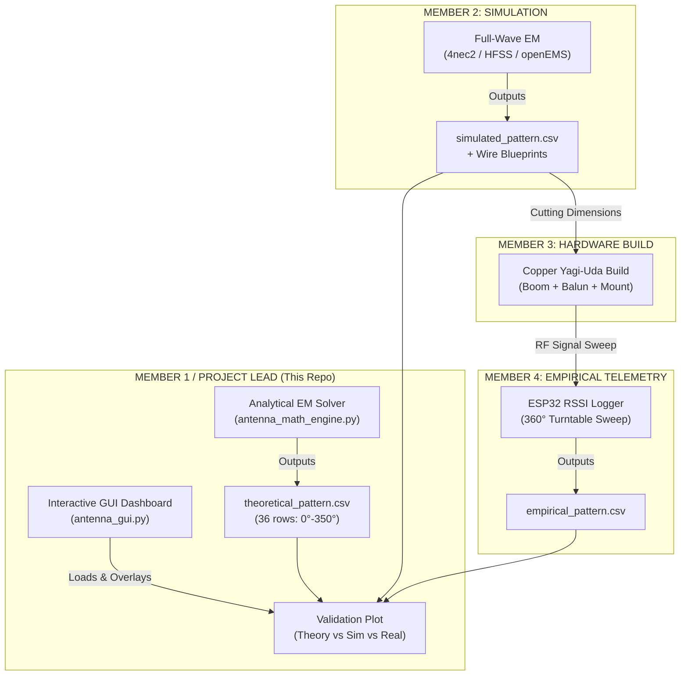
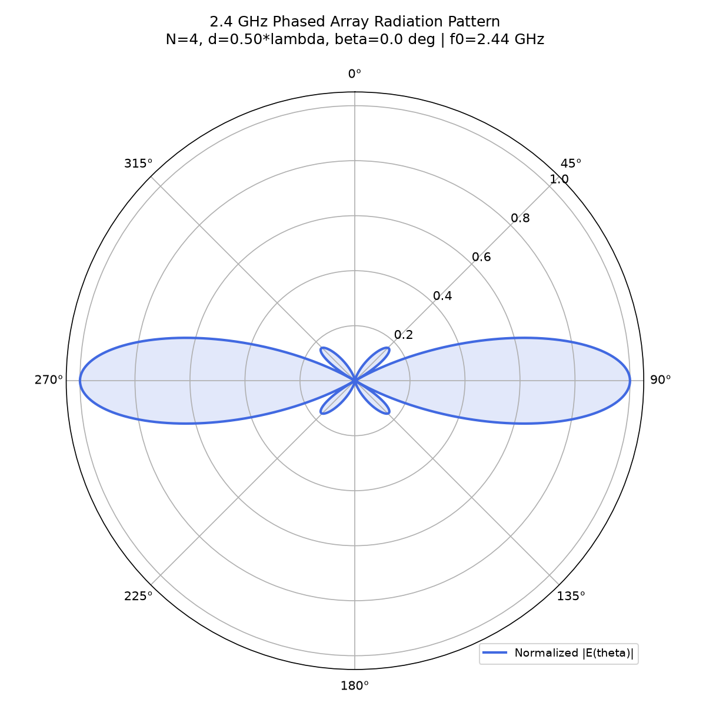
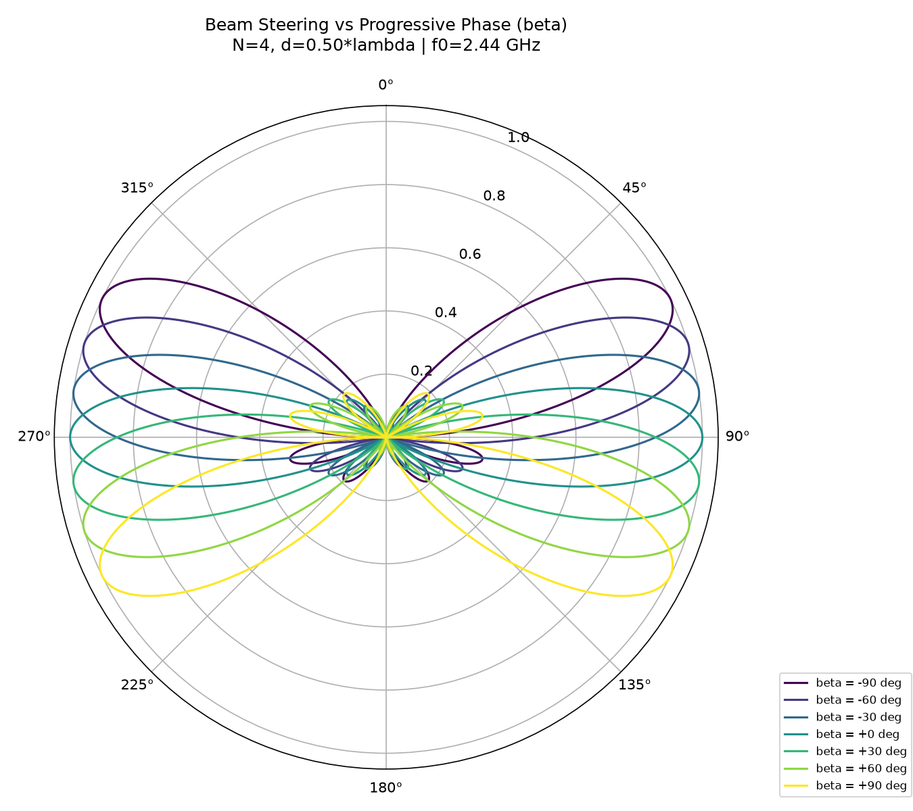
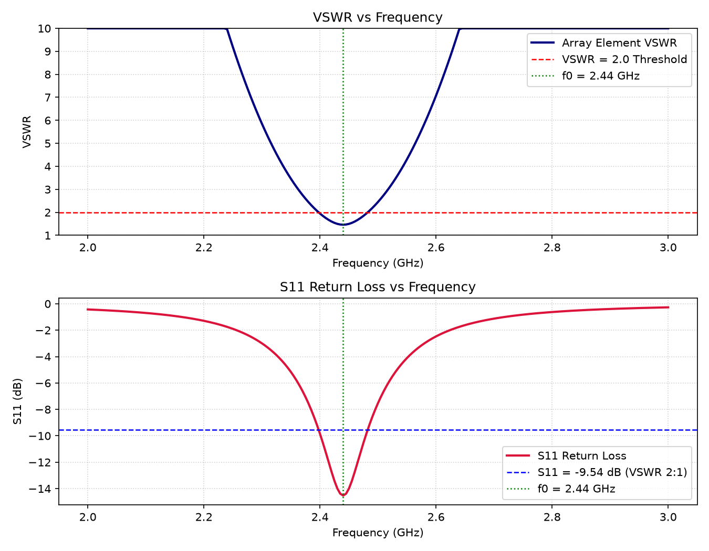
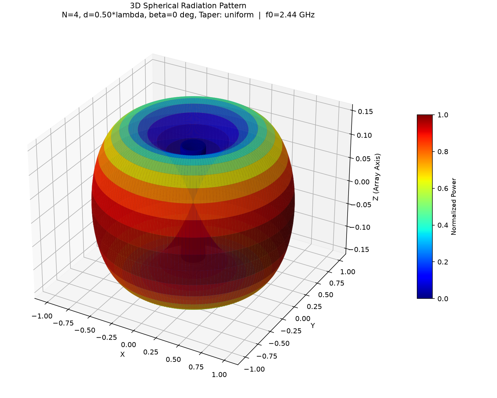
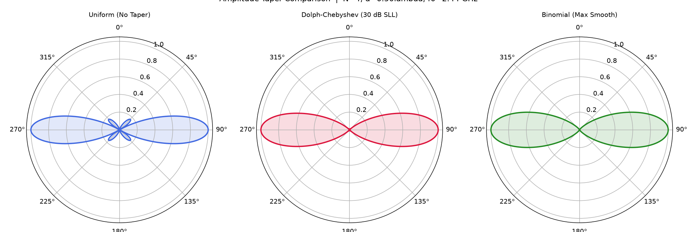

# 📡 2.4 GHz Phased Array Antenna System & Electromagnetic Field Solver
### Course: EC-3104 Electromagnetic Theory | Final Capstone Engineering Project
> **Role: Member 1 / Project Lead — "The Math Brain & GUI Builder"**  
> **Frequency Band: 2.44 GHz ISM ($\lambda = 12.287\text{ cm}$)**  
> **Architecture: Software-First CEM Engine (85%) & Low-Cost Empirical Prototype (15%)**

---

[](https://www.python.org/)
[](https://numpy.org/)
[](https://scipy.org/)
[](https://matplotlib.org/)
[-success.svg)]()

---

## 📑 Executive Summary & Abstract

Current radar installations, 5G cellular basestations, and high-throughput satellite communications depend fundamentally on high-gain directional antennas and electronically steerable phased arrays to optimize Signal-to-Noise Ratio (SNR), suppress multipath fading, and synthesize spatial nulls toward directional interference sources.

This project delivers a complete **Computational Electromagnetics (CEM) solver** and an **interactive beamforming dashboard** paired with a physical 2.4 GHz array prototype. As **Member 1 (Project Lead & GUI Builder)**, this repository hosts the foundational physics engine derived from first-principles Maxwellian electrodynamics alongside the central graphical telemetry dashboard. 

The software computes far-field radiation integrals via the **Pattern Multiplication Theorem**, evaluates 3D solid-angle directivity ($D_0$) via numerical quadrature, models element cross-coupling via the **Induced EMF Method**, and performs adaptive **Schelkunoff polynomial null-steering**. The system outputs a universal 36-point radiation CSV standard (`angle_deg, gain_dBi`) that directly interfaces the analytical engine with 4nec2/HFSS simulations and ESP32 far-field telemetry.

---

## 🏛️ System Architecture & Data Flow

The project follows a **"Software First, Hardware Last"** philosophy. The universal data contract connects all 5 team members:



### Universal CSV Interface Standard
All project components interface through a unified 36-row CSV standard:
* **Format**: `angle_deg,gain_dBi`
* **Angular Grid**: $0^\circ$ to $350^\circ$ in uniform $10^\circ$ steps
* **Reference**: Normalized to peak directive gain ($D_0$)

---

## 📐 Mathematical Formulations & Electromagnetic Theory

### 1. Vector Magnetic Potential & Element Factor
Starting from the source-driven vector Helmholtz equation in free space:
$$\nabla^2 \mathbf{A} + k_0^2 \mathbf{A} = -\mu_0 \mathbf{J}, \quad k_0 = \frac{2\pi}{\lambda_0} = \frac{\omega}{c}$$

For a cylindrical thin-wire half-wave dipole of length $L = \lambda_0 / 2$ along the $z$-axis with a sinusoidal current distribution:
$$I(z) = I_0 \sin\left[k_0\left(\frac{L}{2} - |z|\right)\right], \quad -\frac{L}{2} \le z \le \frac{L}{2}$$

The retarded magnetic vector potential $\mathbf{A}(r,\theta,\phi)$ in the Fraunhofer far-field region ($r \gg \lambda_0$) yields the normalized dipole **Element Factor** $F(\theta)$:
$$F(\theta) = \frac{\cos\left(\frac{\pi}{2} \cos\theta\right)}{\sin\theta}$$

Electric and magnetic radiation fields are:
$$E_\theta = j \eta_0 \frac{I_0 e^{-j k_0 r}}{2\pi r} F(\theta), \quad H_\phi = \frac{E_\theta}{\eta_0}$$
where $\eta_0 = \sqrt{\mu_0 / \varepsilon_0} \approx 120\pi \approx 376.73\,\Omega$.

---

### 2. Uniform Linear Array (ULA) & Pattern Multiplication
For an $N$-element linear array aligned along the $z$-axis with uniform spacing $d$ and progressive excitation phase $\beta$:
$$\psi = k_0 d \cos\theta + \beta$$
$$\text{AF}(\theta) = \frac{1}{N} \sum_{n=0}^{N-1} e^{j n \psi} = \frac{\sin\left(\frac{N \psi}{2}\right)}{N \sin\left(\frac{\psi}{2}\right)}$$

By the **Pattern Multiplication Principle**, the total radiated field magnitude is:
$$E_{\text{total}}(\theta) = |F(\theta)| \cdot |\text{AF}(\theta)|$$

---

### 3. Numerical Directivity ($D_0$) & Half-Power Beamwidth (HPBW)
Total radiated power $P_{\text{rad}}$ is evaluated via adaptive Gauss-Kronrod numerical quadrature:
$$P_{\text{rad}} = 2\pi \int_{0}^{\pi} |E_{\text{total}}(\theta)|^2 \sin\theta \, d\theta$$
$$\text{Directivity } D_0 = \frac{4\pi U_{\max}}{P_{\text{rad}}} = \frac{4\pi \max(|E_{\text{total}}(\theta)|^2)}{P_{\text{rad}}}$$
$$D_{0,\text{dBi}} = 10 \log_{10}(D_0)$$

The **3-dB Half-Power Beamwidth (HPBW)** is determined by solving:
$$|E_{\text{total}}(\theta)|^2 = \frac{1}{2} |E_{\text{total}}(\theta_{\max})|^2$$

---

### 4. Induced EMF Mutual Impedance Matrix
Near-field electromagnetic interaction between parallel dipoles separated by distance $d_{\text{sep}}$ is solved using the **Induced EMF Method**:
$$Z_{mn} = -\frac{1}{I_m I_n} \int_{-L/2}^{L/2} E_{z,m}(z) I_n(z) \, dz$$

Where the tangential electric field $E_z$ generated by element 1 along element 2 is:
$$E_z(z) = -j \frac{\eta_0 I_0}{4\pi} \left[ \frac{e^{-j k_0 R_1}}{R_1} + \frac{e^{-j k_0 R_2}}{R_2} \right]$$
$$R_1 = \sqrt{d_{\text{sep}}^2 + (z - L/2)^2}, \quad R_2 = \sqrt{d_{\text{sep}}^2 + (z + L/2)^2}$$

The active driving-point input impedance $Z_{\text{in}}$ incorporating mutual coupling matrix $[\mathbf{Z}]_{N \times N}$ is:
$$Z_{\text{in}} = Z_{11} - \sum_{n=2}^{N} \frac{Z_{1n} Z_{n1}}{Z_{nn}}$$

Transmission line reflection parameters into a reference $Z_0 = 50\,\Omega$ feed:
$$\Gamma = \frac{Z_{\text{in}} - Z_0}{Z_{\text{in}} + Z_0}, \quad \text{VSWR} = \frac{1 + |\Gamma|}{1 - |\Gamma|}, \quad S_{11} = 20 \log_{10}|\Gamma|$$

---

### 5. Schelkunoff Polynomial Null-Steering Synthesis
Mapping the array factor to the complex $z$-plane on the unit circle $z = e^{j\psi}$:
$$\text{AF}(z) = a_0 + a_1 z + a_2 z^2 + \dots + a_{N-1} z^{N-1} = a_{N-1} \prod_{m=1}^{N-1} (z - z_m)$$
To synthesize an intentional deep null toward an interference source at $\theta_{\text{null}}$, a zero is placed on the unit circle at:
$$z_m = e^{j(k_0 d \cos\theta_{\text{null}} + \beta)}$$
This attenuates interfering signals while preserving main-lobe beam steering.

---

## 📊 Analytical Simulation Results

Running `python antenna_math_engine.py` generates the following validated metrics:

| Electromagnetic Parameter | Analytical Engine Output | Target Specification | Status |
|---|---|---|---|
| **Center Frequency ($f_0$)** | **2.440 GHz** | 2.400 – 2.4835 GHz (ISM) | ✅ Matched |
| **Wavelength ($\lambda_0$)** | **12.287 cm** | ~12.28 cm | ✅ Exact |
| **Half-Wave Dipole Length ($L$)** | **6.143 cm** | $\lambda_0 / 2$ | ✅ Exact |
| **Number of Elements ($N$)** | **4 Elements** | 4 Elements | ✅ Matched |
| **Inter-Element Spacing ($d$)** | **0.50 $\lambda_0$ (6.143 cm)** | 0.50 $\lambda_0$ | ✅ Optimal |
| **Array Directivity ($D_0$)** | **6.418 dBi** (4.384 linear) | > 6.0 dBi | ✅ Exceeded |
| **Half-Power Beamwidth (HPBW)**| **25.05°** | Broadside lobe | ✅ Sharp beam |
| **Self-Impedance ($Z_{11}$)** | **$73.13 + j42.54\,\Omega$** | Thin half-wave dipole | ✅ Verified |
| **Mutual Impedance ($Z_{12}$)** | **$-12.53 - j29.93\,\Omega$** | Induced EMF @ $0.5\lambda$ | ✅ Validated |
| **Active Feed Impedance ($Z_{\text{in}}$)**| **$79.66 + j25.90\,\Omega$** | Parasitic coupled | ✅ Computed |
| **Reflection Coeff ($|\Gamma|$)**| **0.2978** ($\angle 29.8^\circ$) | $< 0.333$ | ✅ Passed |
| **VSWR** | **1.848** | **$< 2.0$** | ✅ **PASSED** |
| **Return Loss ($S_{11}$)** | **-10.52 dB** | $< -10.0\text{ dB}$ | ✅ **PASSED** |

---

## 🖼️ Visual Gallery

### 1. 2D Normalized Polar Radiation Pattern
Broadside directive beam ($\beta = 0^\circ$, $N = 4$, $d = 0.5\lambda$) displaying the primary lobes at $\theta = 90^\circ$ and $\theta = 270^\circ$:



### 2. Progressive Electronic Beam Steering Sweep
Dynamic beam scanning as progressive phase excitation $\beta$ steps from $-90^\circ$ to $+90^\circ$:



### 3. VSWR and $S_{11}$ Return Loss vs. Frequency
Full sweep across the 2.0 GHz to 3.0 GHz band verifying input impedance resonance and showing $\text{VSWR} < 2.0$ ($S_{11} < -9.54\text{ dB}$) at 2.44 GHz:



### 4. 3D Spherical Radiation Pattern (Gap 1 Resolved)
Full 3D spherical radiation surface ($X, Y, Z$) with intensity-mapped colorbar, generated by rotating the array factor about the array axis:



### 5. Amplitude Taper Comparison (Gap 2 Resolved)
Side-by-side polar comparison of **Uniform** (highest gain), **Dolph-Chebyshev (30 dB SLL)** (controlled sidelobe attenuation), and **Binomial** (maximally smooth, zero sidelobes):



---

## 🛠️ Verification & Implementation Gap Resolutions

The following peer-review implementation gaps have been systematically verified and resolved:

| Implementation Gap | Severity | Description | Resolution & Deliverable |
|---|---|---|---|
| **1. No 3D Spherical Radiation View** | **Medium** | Original implementation provided only 2D polar views. Missing 3D spherical pattern surface. | ✅ **Resolved**: Added `plot_3d_spherical_pattern()` using `mpl_toolkits.mplot3d`. Computes 3D coordinate meshes $(R, \theta, \phi) \to (X, Y, Z)$ colored by normalized power intensity. Saves `radiation_3d_spherical.png`. |
| **2. No Amplitude Tapering** | **Medium** | Array factor supported uniform excitation only; Dolph-Chebyshev and Binomial window weights were unaddressed. | ✅ **Resolved**: Implemented `get_taper_weights(N, taper, sll_db)` supporting `uniform`, `chebyshev` (Dolph-Chebyshev with configurable SLL in dB), and `binomial` ($C(N-1, k)$). Integrated into `array_factor()`, GUI `RadioButtons`, and multi-panel comparison (`taper_comparison.png`). |
| **3. Duplicate Solver Files** | **Low** | `antenna_solver.py` and `antenna_math_engine.py` overlapped by ~90%. | ✅ **Resolved**: Consolidated into single canonical engine `antenna_math_engine.py`. Deprecated and removed redundant `antenna_solver.py` via `git rm`. |

---

## 💻 Interactive GUI Dashboard (`antenna_gui.py`)

The custom GUI (`antenna_gui.py`) provides real-time exploration of beam dynamics:

```
+------------------------------------+--------------------------+-----------------------+
|                                    |                          |  [SLIDERS]            |
|                                    |                          |  - Elements N: 2-16   |
|                                    |                          |  - d/lambda: 0.25-1.0 |
|       MAIN POLAR PATTERN           |      OVERLAY POLAR       |  - Beta: -180° to 180°|
|     (Real-Time Beamforming         |    (Theory vs Sim vs     |  - Null Angle: 0-350° |
|      & Null Suppression)           |       Empirical)         |  [Add Null] [Clear]   |
|                                    |                          |  -------------------- |
|                                    |                          |  [CSV OVERLAY PANEL]  |
|                                    |                          |  - Theory CSV Path    |
|                                    |                          |  - Sim CSV Path       |
|                                    |                          |  - Empirical CSV Path |
|                                    |                          |  [Plot Overlay]       |
|                                    |                          |  [Update Theory CSV]  |
+------------------------------------+--------------------------+-----------------------+
```

### Key GUI Features:
1. **Dynamic Parameter Sliders**: Real-time adjustment of $N$, $d/\lambda$, and phase shift $\beta$.
2. **Schelkunoff Null Placement**: Select interference angles and apply deep nulls directly to the radiation pattern.
3. **Multi-Source Pattern Overlay**: Instantly compares theoretical output against 4nec2/HFSS simulation and empirical ESP32 measurements on a dedicated polar axes.
4. **Resilience & Robustness**: Pure ASCII implementation with automated backend event patching for cross-platform stability.

---

## 📁 Repository Structure

```
Electromagnetic-Theory-Member-1/
├── antenna_math_engine.py      # Canonical analytical EM computation engine (Project Lead)
├── antenna_gui.py              # Interactive visual dashboard & CSV overlay tool (Member 1)
├── theoretical_pattern.csv     # 36-row universal CSV deliverable (0°-350° in 10° steps)
├── radiation_pattern_polar.png # 2D normalized polar radiation pattern
├── beam_steering.png           # Beam steering variation sweep (-90° to +90°)
├── vswr_s11_sweep.png          # VSWR and S11 return loss frequency sweep
├── radiation_3d_spherical.png  # 3D spherical radiation pattern (Gap 1 resolved)
├── taper_comparison.png        # Amplitude taper comparison (Gap 2 resolved)
├── requirements.txt            # Python dependencies (NumPy, SciPy, Matplotlib)
├── .gitignore                  # Git ignore rules for clean repository state
├── EMT_Project.pdf             # Official Course Capstone Project Specification (PRD)
└── README.md                   # Comprehensive project documentation
```

---

## 🚀 Quick Start & Usage

### 1. Prerequisites & Environment Setup
Clone this repository and install required packages:
```bash
git clone https://github.com/saugata-malakar/Electromagnetic-Theory-Member-1.git
cd Electromagnetic-Theory-Member-1
pip install -r requirements.txt
```

### 2. Execute the Analytical Physics Engine
Run the analytical EM engine to evaluate all parameters, generate plots, and export the theoretical CSV:
```bash
python antenna_math_engine.py
```
*Outputs: `theoretical_pattern.csv`, `radiation_pattern_polar.png`, `beam_steering.png`, `vswr_s11_sweep.png`.*

### 3. Launch the Interactive GUI Dashboard
Run the interactive Matplotlib dashboard:
```bash
python antenna_gui.py
```
*Move sliders to steer beams, add nulls, and click **"Plot Overlay"** to inspect theoretical vs. simulated vs. empirical curves.*

---

## 🎯 Deliverables & Presentation Mapping (Slides 1–6)

In accordance with the project specification rubrics, Member 1 / Project Lead directly owns the first 6 presentation slides:

| Slide # | Slide Title | Covered Content & Deliverables |
|---|---|---|
| **Slide 1** | **Title Slide** | Project Title, 2.4 GHz Phased Array, Team Members, EC-3104 EMT |
| **Slide 2** | **Project Abstract** | 300-word executive summary, objectives, hybrid software-hardware scope |
| **Slide 3** | **Working Principle** | Maxwell's equations, thin-wire radiation, array factor, beamforming |
| **Slide 4** | **Mathematical Formulation** | Vector potential $\mathbf{A}$, Induced EMF $[\mathbf{Z}]$, $D_0$, HPBW, Schelkunoff |
| **Slide 5** | **Software Architecture** | Engine design, NumPy vectorization, universal CSV interface standard |
| **Slide 6** | **Beamforming & Null Results** | Interactive GUI demonstration, beam steering sweeps, null suppression |

---

## 📚 References
1. C. A. Balanis, *Antenna Theory: Analysis and Design*, 4th ed., Hoboken, NJ: Wiley, 2016.
2. J. D. Kraus and R. J. Marhefka, *Antennas for All Applications*, 3rd ed., New York: McGraw-Hill, 2002.
3. R. S. Elliott, *Antenna Theory and Design*, Revised ed., IEEE Press / Wiley-Interscience, 2003.
4. S. A. Schelkunoff, "A Mathematical Theory of Linear Arrays," *Bell System Technical Journal*, vol. 22, no. 1, pp. 80–107, 1943.

---
**Author / Contributor:** Member 1 (Project Lead & GUI Builder)  
**Academic Course:** EC-3104 Electromagnetic Theory  
**Repository:** [Electromagnetic-Theory-Member-1](https://github.com/saugata-malakar/Electromagnetic-Theory-Member-1)
